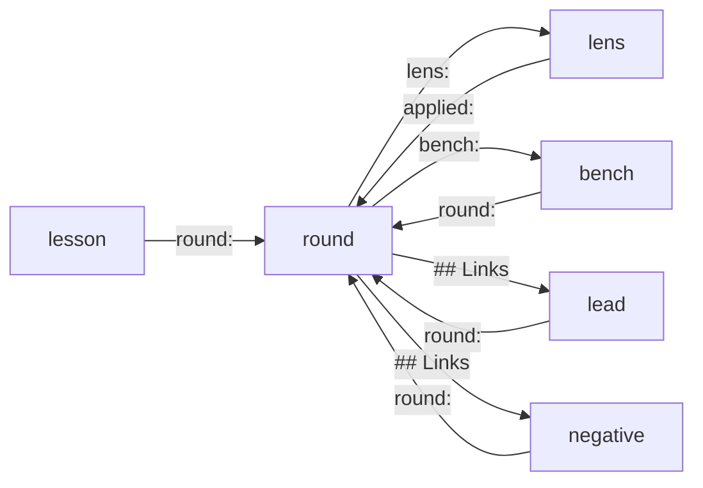

# LOOP.md — map of the evidence-loop data

Data of a find-and-fix loop; the rules live in the `evidence-loop`
skill (SKILL.md, specs/, methods/). Navigation only here.

## Seven entities, one directory each

- **Lens** — a hypothesis generator: what to look for and how. `lenses/`, ordered by `rank:`.
- **Round** — what was measured, fixed, and with which verdict. `rounds/`.
- **Lead** — the unfinished: a deferral, a wait on the owner, a bench with no number. `backlog/`, ordered by `rank:`.
- **Negative** — measured, clean, nothing to do. `checked/`.
- **Bench** — a probe whose control proved it can see the defect; reused. `probes/`.
- **Lesson** — a rule for working with this code that a round paid for. `lessons/`.
- **Invariant** — the owner's: a property that must hold, and its test. `invariants/`. A round never edits one.

There are no index files. The records are the only copy; `loop.py find`,
`status` and `next` read them.

## Who points at whom

## Where to go with a question

- Run a round — the skill, default mode; start with `loop.py status`.
- The next round's number — `loop.py status` (the maximum in `rounds/` plus one).
- Has this been checked? — `loop.py find <text>` or `loop.py find --path <file>`,
  and the `swept here` lens statuses.
- Where a claim came from — by ID: `loop.py find <ID>`.
- What awaits the owner — `loop.py status`; to answer, write into the
  `## Owner decision` section of the lead's file, leave the status alone.
- What has aged against the code — `loop.py stale`.
- The state the next round chooses from — `loop.py next`. It names no target.
- Is there a ready bench for this surface — `loop.py find --path <file> --kind probe`
  or `loop.py next`.
- What we learned on this code — `loop.py status` lists the active lessons.
- The order to take leads and lenses in — `loop.py next`; to change it,
  `loop.py rank <ID> <POSITION>`.

## What to trust with care

- The lens set (PL-1 to PL-5) is derived, not swept: no round has checked any
  of it. Every lens is a hypothesis; its `status: derived` says so.
- The backlog leads B-1 and B-2 and the negatives C-1 and C-2 were carried
  over from prior knowledge at setup, not re-measured by a round: they carry
  `round: — (not re-measured)` and `commit: f68582b`. C-2's numbers WERE
  measured at setup (the suites were run); its claim is still a green-run
  snapshot, not a round's verdict.
- C-1 copies the closures of the doc audit (`docs/протечки.md`) so the loop
  does not re-open them; the doc's «closed» marks beyond that record are the
  doc's word, not the journal's.
- No unrecovered history: no round ran before the journal was laid out;
  numbering starts at 1.
- The gate is red at setup (two import lints, see B-2) — a round's gate step
  must tell these known lines from its own.
