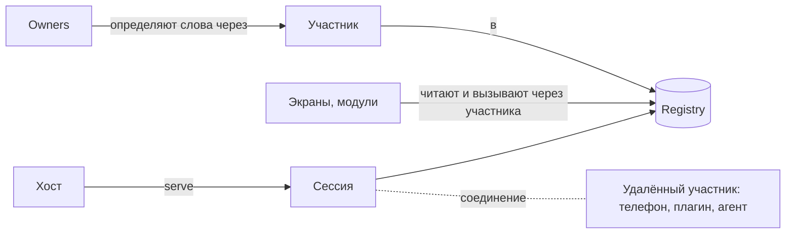

# parlance — справочник терминов

Термины пакета `packages/parlance` с примерами из Tephra. Здесь только смысл. Точный контракт описан в `packages/parlance/skills/parlance/references/` (номера разделов указаны как §N).

parlance — это язык, которым части приложения говорят друг с другом, не зная друг друга: слова, права, причины и логи. Поведения в нём нет. Правила вида «когда X, сделай Y» пишет хост в своём коде поверх тиков, фактов и вызовов.

## Основа

**Registry** — общий словарь приложения. Хранит слова и их текущие значения, принимает вызовы, раздаёт изменения тиками. В Tephra он один, создаётся в `main.dart`.

**Слово (word)** — имя в registry с типом и правилами доступа. Видов четыре: состояние, команда, вопрос, факт. Все слова приложения вместе — его словарь и его публичный API. Имена пишутся строчными словами через точку, внутри слова через `_` или `-`: `audio.muted`, `stream.go`, `kitten-daycare.lights`.

**Состояние (state)** — то, что есть сейчас. Его можно прочитать и подписаться на изменения. Пример: `stream.phase = live`.
- **Ключевое состояние (keyed)** держит по значению на каждый ключ, сущность какого-то вида. Пример: `audio.muted[mic] = true`.
- **Пишет только владелец.** Остальные просят его командой, и владелец сам решает, что записать.

**Команда (command)** — просьба что-то сделать: имя, параметры, необязательный ответ. У каждой команды ровно один обработчик. Пример: `audio.mute {input: mic, on: true}`. Команда ничего не говорит о том, какие состояния запишет её обработчик: это дело владельца, а что он сделал, видно потом по причинам.

**Вопрос (query)** — слово, которое только отвечает: поиск, страница, снимок по параметрам. Ничего не меняет, поэтому его безопасно спрашивать снова. Нет дедупликации и записи вызова. Запись, факт или вызов команды из его обработчика отклоняются (`QueryEffect`).

**Факт (fact)** — разовое событие без текущего значения. Пример: `platform.chat {viewer, text}`, `replay.saved`.
- **Открытый факт (open)** могут говорить несколько производителей. Пример: `platform.chat` говорят плагины разных платформ.
- **Повтор отбрасывается.** У факта есть id; факт с уже виденным id в окне дедупликации пропускается, поэтому производитель может безопасно повторить.

**Дескриптор (descriptor)** — описание слова: имя, тип, кто может вызывать или читать, `meta` (подпись, единицы).

**Каталог (catalog)** — все слова и виды сущностей, которые есть сейчас. Меняется на ходу: плагин запустился, и его слова появились. `describeFor(principal)` — каталог с точки зрения конкретного участника.

**Статус слова (§6.5)** — есть ли слово для меня сейчас: `WordMissing`, `WordNotPermitted`, `WordUnavailable(why)`, `WordReady`. Спрашивать статус, а не проверять каталог один раз при старте: слова приходят и уходят. Отсутствующее слово ничего не ломает: чтение даёт null, слушатель молчит, пока слово не появится.

**Тип (type)** — что может быть значением: `bool`, `int`, `num`, `text`, `enum`, `ref` (ссылка на сущность), объект, список, словарь, `any`. Registry проверяет значения и параметры по типу.

**Вид сущностей (entity kind)** и **сущность (entity)** — то, на что ссылаются ключи и `ref`-параметры: id, подпись и `meta`. Владелец сам отдаёт текущий список. Примеры в Tephra: `scene`, `input`.

**Старое имя (alias) и версии** — слово — это публичный API, поэтому переименованное слово сохраняет старое имя (`registry.alias(old, now)`). Несовместимое изменение — новое слово с версией в имени: `orders.order.v2`.

## Кто и почему

**Principal** — кто действует. Это путь: вид, затем уровни id через `/`. Примеры:
- `user/local` — стример за маком;
- `remote/Pixel` — телефон;
- `agent/<сессия>` — ИИ-агент;
- `plugin/hydra` — плагин;
- `viewer/twitch.123` — зритель;
- `studio@sound` — часть студии, owner микшера;
- `system` — сам registry.

Форма principal: `kind[/id][@owner]`, id из одного уровня, owner из одного имени. У principal есть части, его owners: `child(name)` добавляет `@name`, и в причинах видно, какой owner что сделал. У части частей нет.

**Callers** — кто может вызывать команду: `*` или путь (`user`, `plugin/hydra`, `viewer/twitch`). Каждое правило — `allow`, `warn` или `deny`. Выигрывает самое близкое; кто не подошёл ни под одно, тому отказ. `warn` разрешает вызов, но редактор предупредит. В Tephra есть готовые наборы `Who.crew`, `Who.crewAndViewers`, `Who.streamerAtTheMac`.

**Readers** — кто может читать состояние или слышать факт снаружи процесса: удалённые участники и агенты.

**Askers** — кто может задавать вопрос; по умолчанию те же, кто читает.

**Cause** — почему что-то произошло: от чьего имени (`by`) и из какого сообщения (`parent`). Передаётся явно: обработчик пишет с `call.causeFor(by)`. По причинам `explain` объясняет, откуда взялось значение.

**Разговор (conversation)** — всё, что выросло из одного сообщения, сколько бы шагов ни было: строка в чате, вызов, который она запустила, таймер, который этот вызов поставил, и то, что таймер сделал через минуту. У каждого сообщения разговора одинаковый `conversation` — id сообщения, с которого всё началось. `parent` говорит, что вызвало сообщение, `conversation` — частью чего оно является, `origin` — с чего разговор начался: слово первого сообщения и от чьего имени (`{word, by}`); какой именно это разговор, говорит `conversation`. У первого сообщения origin нет — оно само себе origin (`cause.originOf(word)`). По слову origin находятся все слова, к которым привёл, например, `platform.chat` (`JournalReader.startedWith`). Origin даёт registry по родителю и не берёт из cause того, кто действует, поэтому подделать его нельзя; прав он не даёт, права — у `by`. `registry.conversation(id)` отдаёт всё, что registry ещё помнит о разговоре; в телеметрии он лежит в атрибуте `conversation` каждого span, так что по нему ищется в бэкенде через дни и процессы, чего не умеет trace.

**explain (why)** — почему состояние такое: его значение, последнее изменение и цепочка вызовов, которая к нему привела.

## Участники и владельцы (§19, §22)

**Участник (participant)** — часть приложения, как она говорит с registry: один principal, свои словари, свои права. Модуль никогда не держит сам registry, только своего участника. `main` создаёт участника: `registry.participant(who, vocabularies:, rights:, access:)`.
- **Словарь (vocabulary)** — набор слов одного owner под общим именем: `screen` для `screen.cover.set`. Участник определяет слова только в своих словарях (`plugin/hydra` только `hydra.*`); словарь принадлежит одному участнику, и два словаря одного участника не могут совпадать или вкладываться друг в друга.
- **Права (rights)** — что можно сверх чтения и вызовов: `define` (какие слова объявлять), `produce` (какие открытые факты говорить), `speakFor` (от чьего имени).
- **Доступ по умолчанию (access)** — кто может читать и вызывать его слова, если слово само не сказало.
- **Область (scope)** — участник живёт столько, сколько то, чему он служит: вход пользователя, открытая функция. При `dispose` уходит всё, что он сделал.

**Owner** — код, который владеет словами и выполняет их работу.
- `define(p)` объявляет слова через участника и хранит их ручки (`keep`).
- `sync()` записывает текущие значения.
- `changes` — поток «модель сдвинулась»; тогда owner синхронизируется сам.
- `attach({'sound': Mixer()})` на участнике подключает owners, каждого как часть (`studio/sound`).

В Tephra это `core/owners/*` на сгенерированных базах: `Mixer` на `SoundOwner` и другие.

**Порт (port)** — интерфейс, через который owner обращается к тому, кто делает работу. Это термин Tephra, не parlance.

**trackKind** — owner ведёт вид сущностей. При изменении списка сообщает об этом и убирает значения ушедших ключей.

**failCall(why)** — обработчик говорит «нет» по существу. Вызов кончается `failed` с этой причиной.

## Изменения во времени

**Тик (tick)** — единица изменения. Всё, что записано и сказано вместе, коммитится одним тиком: `Tick {epoch, from, to, changes, facts}`. Никто не видит половину тика.

**Batch** — `batch(() {...})`: всё внутри становится одним тиком. `sync()` участника делает так, чтобы изменение всех его owners было одним тиком.

**seq** — порядковый номер каждого изменения и факта внутри эпохи.

**Epoch** — id запуска registry, новый при каждом старте.

**Feed** — поток для удалённых участников: сначала снимок (или сохранённые тики после известного `seq`), потом живые тики.

## Вызовы

**Вызов (call)** — проходит этапы по порядку, первый отказ его останавливает:
1. дедупликация по id (не для вопросов);
2. поиск команды;
3. проверка параметров;
4. проверка `callers`;
5. доступность;
6. guards;
7. обработчик.

**CallResult** — чем кончился вызов:
- `done(value)` — выполнен, единственный вариант с ответом;
- `refused(code, reason)` — отказ до запуска. Коды: `unknownCommand`, `invalidParams`, `notPermitted`, `unavailable`, `denied`, `idConflict`;
- `failed(error)` — обработчик сказал «нет» или упал;
- `timedOut` — ответа не было вовремя, но обработчик мог дойти до конца позже;
- `lost(id)` — ответ потерялся по сети; повтор с тем же id выполнит вызов не больше одного раза.

**Доступность (available)** — проверка владельца «можно ли сейчас», с причиной. Пример: `stream.stop` недоступна, когда эфира нет.

**Guard** — общее правило «нельзя», проверяется на каждом вызове. Если guard помечен `overridable`, principal из `overriders` может продавить отказ (`override`).

**Call record** — запись о каждом завершённом вызове: кто, что, с каким результатом, сколько заняло (`registry.calls`). `callStarts` сообщает о вызове, когда начинает работать его обработчик, `running` — какие вызовы выполняются сейчас.

## Учёт использования слов (§6.8)

**usesOf / usage** — кто пользовался словом из того, что не видит компилятор: вызовы, подписки удалённых участников, чтения по имени. Считается по имени, которым назвали, так что видно, кто ещё зовёт старое имя. Нужно, чтобы понять, когда старую версию слова можно удалять.

## Типизированные слова и генератор (§18, §23)

**IStateWord / ICommandWord / IQueryWord / IFactWord** — имя слова, его тип в Dart и форма JSON в одном месте. Вызов выглядит так: `registry.command(SoundCommand.mute).call((input: 'mic', on: true), by: Who.user)`.

**Shape** — как значение превращается из JSON в Dart-тип и обратно: `Plain`, `EnumShape`, `RecordShape`, `ListShape`, `MapShape`, `Nullable`.

**@Vocabulary** — словарь модуля, написанный один раз абстрактным классом. `parlance_generator` делает по нему enum-слова, базу владельца (`<Class>Owner`, в ней пишутся только обработчики) и клиента (`<Class>Client(view)`) для потребителей.

## Удалённо (remote, §14)

**Сессия (RemoteSession)** — подключение одного участника по соединению. Хост создаёт участника так же, как для локального модуля, и отдаёт его: `registry.participant(Who.plugin(id), vocabularies: [...], rights: ...).serve(endpoint)`. Отдать можно только нового участника и только один раз. С закрытием сессии уходит участник и его слова.

**Удалённый участник (RemoteParticipant)** — та же часть приложения на другом конце: тот же `IParticipant`, к нему подключаются те же owners. `RemoteParticipant.join(connection)` переподключается сам после обрыва. `RemoteParticipant.over(endpoint)` — поверх готового endpoint, который не возвращается (гость wasm или JS). Это единственный способ работать через соединение; провод, клиент и зеркало — внутренности пакета. Interceptors (например, пара OTel) вешаются на endpoint: на хосте до `serve`, у `join` через `interceptors:`.

**Подписка** — удалённый участник держит только то, на что смотрят его слушатели, и то, что он читал по имени (`fetch`). Слово, которое ему читать нельзя, в подписку не попадает и не мешает остальным.

**Доставка (§14.1)** — что обещано каждому виду сообщений:
- состояние приходит как текущее значение;
- факт — не больше одного раза; после долгого обрыва снимок говорит `factsLost`;
- вызов — один раз на id; `lost` означает «мог выполниться», повторить с тем же id.

Факт, сказанный без связи, ждёт переподключения: хранятся последние `keepAway` (1000). Факт, который нельзя потерять, — это не факт, а состояние у владельца, пока его не обработали.

**Протокол** — обе стороны говорят на одной версии; при несовпадении подключение отклоняется (`ProtocolMismatch`). Если хост недоступен, приходит `RegistryUnreachable`.

## Экраны (view, §20)

**IRegistryView** — то, через что экран читает и вызывает: синхронное чтение, уведомления об изменениях нужных состояний, вызовы от имени одного principal.
- **LocalView** — поверх registry в своём процессе. Пример: пульт на маке.
- **Удалённый участник** — тоже view. Пример: телефон.

**fetch(state)** — чтение по имени, в том числе того, на что не подписан: так читают плагины и агенты. Через соединение участник с этого момента следит за словом; `keep: false` — посмотреть один раз.

**WordsBuilder** — Tephra-виджет, который перерисовывается, когда меняются его слова.

## Агенты (mcp, §16)

**Агент — это участник.** Инструменты MCP работают поверх его `IParticipant`, в процессе или через соединение: `parlanceTools(participant)`.

**parlanceTools** — готовый набор инструментов агента: `describe`, `read`, `call`, `recent_facts`, `why`, плюс по инструменту на каждую команду, если попросить.

## Логи и телеметрия (§9.2)

**Лог** — `Registry(log:)`, `LogScope` логгера rpc_dart; без него ничего не пишется и не создаётся.

**Span** — каждый вызов при включённом логе. Телеметрию выключает `LogController(spansEnabled: false)`; без синков она тоже ничего не стоит. Вложенный вызов — дочерний span. Вызов, выросший из факта, ссылается на span, в котором факт сказан. Через соединение trace продолжается у удалённого владельца.

## Журнал (§9.3)

**Журнал** — `registry.journal`, что было сделано в системе на уровне пользования, в одном порядке: каждый вызов при начале и при конце (отказы тоже), каждый сказанный факт и каждая запись состояния внутри разговора (у её cause есть `parent`). Собственные записи owner'а о том, как мир устроен сейчас (уровни, таймеры), — не история и в журнал не идут: то, что стоит помнить, owner говорит фактом. Логи и spans рассказывают, как работал код, и могут быть выключены; журнал — запись того, кто что сделал и вслед за чем.

- Поток синхронный, registry ничего из него не хранит: хост пишет его туда, где он не потеряется. `parlance_journal` пишет JSON-строки, файл на день, и читает обратно: разговор целиком (`conversation`), разговор любого сообщения по его id (`of`), путь к сообщению от начала разговора по цепочке `parent` (`pathTo`), разговор деревом для визуализации (`tree`: что к чему привело, у вызова — чем кончился и сколько шёл), всё, что выросло из одного слова (`startedWith`), всё в одном trace (`trace`), связи, которые реально есть (`links`: кто что вызывает вслед за чем, отказы отдельно).
- У каждой записи `epoch`, `n`, `kind`, `conversation`, `origin`, а при включённых spans — `trace` (W3C `traceparent`). По `conversation` разговор находится в бэкенде телеметрии и в строках лога registry, по `trace` — его spans и события.
- Tephra пишет журнал в `~/Library/Application Support/Tephra/journal`, 30 дней.

## Тесты (§24)

**TestHost** — registry для теста:
- заглушки модулей, которые тест не поднимает: `stateOf`, `commandOf`, `factOf`;
- модуль под тестом в процессе или через соединение (`join`);
- что произошло: `written`, `said`, `callsOf`.

## Что убрано из parlance

Убрано, потому что описывало поведение, которое расходится с кодом, или было нужно на всякий случай:
- **связи (links)**: реакции, привязки, ограничения, контролы, кнопки, чат-команды;
- **слои** и `temporarily`;
- `flip` и `sets`;
- `uses` и декларации;
- before-хуки, `interceptable`, `hurry`;
- метка `test` и `chain` в причинах;
- `RegistryResponder`, `ParlanceClient`, `RemoteOwner`, зеркало и доски MCP как публичный API.

Правила «когда X, сделай Y» и «пока сцена в эфире, держи Z» — код хоста (в Tephra — её owners) поверх тиков, фактов и вызовов.
