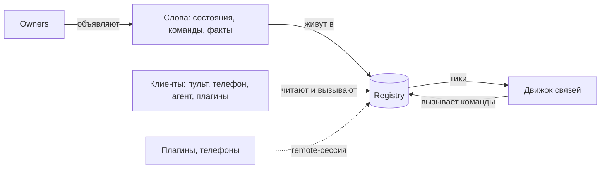

# parlance — справочник терминов

Термины пакета `packages/parlance` с примерами из Tephra. Здесь только смысл. Точный контракт описан в `packages/parlance/skills/parlance/references/` (номера разделов указаны как §N).

## Основа

**Registry** — общая шина студии. Хранит слова и их текущие значения, принимает вызовы команд, раздаёт изменения. В Tephra он один, создаётся в `main.dart` (`tephraRegistry()`).

**Слово (word)** — имя в registry с типом и правилами доступа. Видов три: состояние, команда, факт. Все слова Tephra вместе — это её словарь, её API. Имена пишутся строчными буквами через точку: `audio.muted`, `stream.go`.

**Состояние (state)** — то, что есть сейчас. Его можно прочитать и подписаться на изменения. Пример: `stream.phase = live`, `screen.cover = false`.
- **Ключевое состояние (keyed)** держит по значению на каждый ключ, сущность какого-то вида. Пример: `audio.muted[mic] = true`, `audio.muted[desktop] = false`.
- **Один писатель.** Писать в состояние может только тот, кто его объявил. Остальные меняют его через команду.

**Команда (command)** — то, что можно попросить сделать: имя, параметры, необязательный ответ. Пример: `audio.mute {input: mic, on: true}`, `studio.scene.show {scene: brb}`. У каждой команды ровно один обработчик.

**Факт (fact)** — разовое событие без текущего значения. Пример: `platform.chat {viewer, text}`, `platform.follow`, `replay.saved`.
- **Открытый факт (open)** могут говорить несколько производителей. Пример: `platform.chat` говорят плагины разных платформ.
- **Повтор отбрасывается.** У факта есть id; факт с уже виденным id в окне дедупликации пропускается, поэтому производитель может безопасно повторить.

**Дескриптор (descriptor)** — описание слова: имя, тип, кто может вызывать или читать, `meta` (подпись, единицы). `StateDescriptor`, `CommandDescriptor`, `FactDescriptor`.

**Каталог (catalog)** — все слова и виды сущностей, которые есть сейчас. Меняется на ходу: плагин запустился, и его слова появились. `describe()` отдаёт каталог целиком, `describeFor(principal)` — каталог с точки зрения конкретного участника.

**Тип (type)** — что может быть значением: `bool`, `int`, `num`, `text`, `enum`, `ref` (ссылка на сущность), объект, список, `any`. Registry проверяет значения и параметры по типу.

**Вид сущностей (entity kind)** и **сущность (entity)** — то, на что ссылаются ключи и `ref`-параметры: id, подпись (`label`) и `meta`. Хозяин сам отдаёт текущий список. Примеры в Tephra: `scene` (сцены), `input` (входы микшера, у микрофона в meta `mic: true`), `field` (поля слоёв плагинов), `link` (связи).

## Кто и почему

**Principal** — кто действует: вид и id. Примеры:
- `user:local` — стример за маком;
- `remote:Pixel` — телефон;
- `agent:<сессия>` — ИИ-агент;
- `plugin:hydra` — плагин;
- `viewer:twitch:123` — зритель;
- `link:<id>` — связь;
- `studio` — owners студии;
- `system` — сам registry.

Виды объявлены в `core/who.dart` (`Who`).

**Callers** — кто может вызывать команду: правила по виду (`user`), по виду и id (`plugin:hydra`) или для всех (`*`). Каждое правило — `allow`, `warn` или `deny`. Выигрывает самое конкретное правило; кто не подошёл ни под одно, тому отказ. `warn` разрешает вызов, но редактор предупредит автора, например: «теперь это может любой зритель». В Tephra есть готовые наборы `Who.crew`, `Who.crewAndViewers`, `Who.streamerAtTheMac`.

**Readers** — кто может читать состояние или слышать факт снаружи процесса: через remote или MCP. Пример: `plugin.<id>.settings` плагина читают только команда студии и сам этот плагин.

**Cause** — почему что-то произошло: кто (`by`), из какого сообщения (`parent`), через какие связи и хуки прошло (`chain`), пробный ли это прогон (`test`). Причина передаётся явно, `call.causeFor(by)`. По ней `why` объясняет, откуда взялось значение, а движок связей ловит петли.

## Изменения во времени

**Тик (tick)** — единица изменения. Всё, что записано и сказано вместе, коммитится одним тиком и доставляется одним сообщением `Tick {epoch, from, to, changes, facts}`. Наблюдатели (связи, удалённые клиенты) никогда не видят половину тика.

**Batch** — `registry.batch(() {...})`: всё внутри становится одним тиком. `Owners.sync()` делает так, чтобы изменение студии было одним тиком.

**seq** — порядковый номер каждого изменения и факта внутри эпохи. Определяет общий порядок.

**Epoch** — id запуска registry, новый при каждом старте. Номера `seq` сравнимы только в пределах одной эпохи; клиент, увидев новую эпоху, начинает со снимка.

**Feed** — поток для удалённых клиентов и журналов: сначала снимок (или сохранённые тики после известного `seq`), потом живые тики.

**Снимок (snapshot)** — все значения состояний сразу, с эпохой и `seq`.

## Вызовы

**Вызов (call)** — `registry.call(command, params, by:)`. Проходит этапы по порядку, первый отказ его останавливает:
1. дедупликация по id;
2. поиск команды;
3. проверка параметров;
4. проверка `callers`;
5. доступность;
6. guards;
7. before-хуки;
8. обработчик.

**CallResult** — чем кончился вызов:
- `done(value)` — выполнен, единственный вариант с ответом;
- `refused(code, reason)` — отказ до запуска. Коды: `unknownCommand`, `invalidParams`, `notPermitted`, `unavailable`, `denied`, `idConflict`;
- `failed(error)` — обработчик сказал «нет» (`failCall`) или упал;
- `timedOut` — ответа не было в отведённое время, но обработчик мог дойти до конца позже;
- `lost(id)` — ответ потерялся по сети; повтор с тем же id выполнит вызов не больше одного раза.

`result.whyNot` — причина словами.

**Доступность (available)** — проверка owner'а «можно ли сейчас», с причиной. Пример: `stream.stop` недоступна, когда эфира нет. Кнопка показывается серой с этой причиной (`whyUnavailable`).

**Sets** — команда объявляет, какое состояние она ставит и из каких параметров. Пример: `audio.mute` ставит `audio.muted[input] = on`. На этом основаны слои, `flip` и подсветка кнопок.

**Guard** — общее правило «нельзя», проверяется на каждом вызове. Пример: `tephra.plugin.settings.own` — плагин меняет только свои настройки. Если guard помечен `overridable`, `user` или `remote` могут продавить отказ (`override`).

**Before-хук (interception)** — код, который выполняется перед командой с `interceptable: true` и может что-то сделать до неё. Отменить вызов он не может.
- **Interceptable** — команду можно перехватить. Пример: `stream.stop`.
- **Hurry** — повторное нажатие того же стримером не ждёт хуков.

**Call record** — запись о каждом завершённом вызове: кто, что, с каким результатом, сколько заняло. Поток `registry.calls`.

## Слои

**Слой (layer)** — аренда значения состояния: «пока я держу, значение X». У слоя есть владелец, приоритет и необязательный срок.
- **Эффективное значение** — значение верхнего слоя.
- **База** — значение, которое было до слоёв; оно возвращается, когда последний слой ушёл.
- **Явная установка** (вызов той же команды не от слоя) сбрасывает слои: стример сильнее.

Пример: блок сцены «пока в эфире» держит `audio.muted[desktop] = true` слоем. Сцена ушла — слой снят, звук вернулся каким был. Слои переживают перезапуск (`exportLayers` и `importLayers` в `live.json`).

## Типизированные слова (§18)

**IStateWord / ICommandWord / IFactWord** — имя слова, его тип в Dart и форма JSON в одном месте. Хозяин держит их в enum (`SoundState.muted`, `SoundCommand.mute`), и имена с параметрами нигде больше вручную не пишутся. Вызов выглядит так: `registry.command(SoundCommand.mute).call((input: 'mic', on: true), by: Who.user)`.

**Shape** — как значение превращается из JSON в Dart-тип и обратно: `Plain`, `EnumShape`, `RecordShape`, `ListShape`, `MapShape`, `Nullable`.

## Owners (§19)

**Owner** — тот, кто объявляет слова и выполняет их работу.
- `define(r)` объявляет слова и хранит их ручки (`keep`).
- `sync()` записывает текущие значения.
- `dispose()` убирает слова.

В Tephra это `core/owners/*`: `SoundOwner`, `StreamOwner`, `ScreenOwner` и другие. Сама работа — в частях `lib/src/live/`, owner обращается к ним через порт.

**Owners** — группа owners на одном registry; `sync()` всех одним тиком.

**Порт (port)** — интерфейс, через который owner обращается к тому, кто делает работу. Пример: `StreamPort` реализует `Broadcast`. Это Tephra-термин, не parlance: `core/ports.dart`.

**trackKind** — owner ведёт вид сущностей. При изменении списка объявляет `entitiesChanged` и убирает значения ушедших ключей.

**failCall(why)** — обработчик говорит «нет» по существу, например «на проекте нет экрана стрима». Вызов кончается `failed` с этой причиной.

**Handles** — набор ручек owner'а; при `dispose` убираются в обратном порядке.

## Связи (links, §13)

**Связь (link)** — правило в виде данных (JSON), которое выполняет движок связей. Виды: реакция, привязка, ограничение, перехват, собственное слово.

**Движок связей (Links)** — исполнитель связей на registry. Получает тики, запускает реакции, держит слои привязок, сам действует как `link:<id>`.

**Реакция (reaction)** — «когда → при условии → сделай».
- **Триггер (`when`)** — на что реагировать: `fact`, `state` (`becomes`, `leaves`, `changes`, `for`), `every`, `at`, `manual`.
- **Условия (`only`)** — проверка состояний перед запуском.
- **Шаги (`do`)** — что делать.
- **Режим (`mode`)** — что если сработала, пока ещё идёт прошлый запуск: `single`, `restart` или `queue`.

Пример: `tephra.voice.muted-talk` — когда `audio.voice.muted-talk` стал `true`, вызвать `signal.raise`.

**Привязка (binding)** — «пока условия выполняются, держать значения» (слоями). Пример: блок сцены `scene.<id>` держит мьюты и накрытие, пока сцена в эфире.

**Якорь (anchor)** — даёт привязке условие и «дом» по сущности. Пример: якорь `scene` — «пока эта сцена в эфире».

**Ограничение (constraint)** — guard, заданный связью: «нельзя вызывать X, пока Y».

**Перехват (interception)** — before-хук, заданный связью.

**Собственные слова (own words)** — `my.<имя>`: команда (последовательность шагов) или состояние (`bool` или `enum` со своим `.set`), которые пользователь создаёт сам.

**Триггер-расширение (trigger extension)** — свой вид триггера от хозяина, который движок переводит в стандартный. В Tephra есть `button` (кнопка пульта, становится `manual`) и `chat` (чат-команда `!clip`, становится фактом `platform.chat` с разбором аргументов и от имени зрителя).

**Шаги**:
- `call` — вызвать команду;
- `flip` — переключить `bool`;
- `wait` — подождать;
- `waitUntil` — ждать факта или условия;
- `temporarily` — временно, слоями.

В параметрах можно ссылаться на `$trigger.<путь>` и `$state.<имя>`, есть строки-шаблоны.

**throttle / once** — не чаще раза в интервал (можно отдельно на каждого зрителя) или один раз до `links.reset`.

**От чьего имени выполняется связь.** Нажатие кнопки — от того, кто нажал. Чат-команда — от зрителя. Время и действия самой студии — от связи `link:<id>`. Поэтому зритель через связь не получает прав больше своих.

**Источник связей (source)** — именованный набор связей от хозяина, только для чтения. В Tephra:
- `tephra` — свои связи студии;
- `plugin:<id>` — связи плагина из манифеста, включаются и выключаются вместе с ним;
- `scenes` — блоки сцен.

**Свои связи (own links)** — связи пользователя, хранятся в проекте. Своя связь с тем же id заменяет связь источника; с `enabled: false` выключает её.

**Статус связи** (`links.status`):
- `active` — работает;
- `unresolved` — ждёт слова, которого пока нет, например плагин ещё не запустился;
- `off` — выключена;
- `disabled` — выключена движком, например за частоту больше 20 раз в минуту;
- `invalid` — ошибка в описании.

**Контрол (control)** — связь, которую можно нажать: реакция с `manual`- или `button`-триггером, чьё условие выполняется. У контрола есть:
- `look` — как рисовать: подпись, иконка, группа;
- `lit` — горит ли;
- `unavailable` — почему нажать нельзя.

Движок держит их состоянием `links.controls`; по нему рисуют пульт и телефон. Нажатие — `links.press`.

**links.try** — пробный прогон связи; всё, что она вызовет, помечено `test`.

## Удалённо (remote, §14)

**Сессия (session)** — подключение одного участника к registry по сети. Principal сессии задаёт хозяин при подключении. Пример: телефон получает сессию `remote:<устройство>`, плагин — `plugin:<id>`.

**RegistryResponder** — сторона хозяина: обслуживает одну сессию.

**ParlanceClient** — сторона участника: вызовы, `describe`, `recent`, `why`.

**SessionRights** — что сессии можно, кроме чтения и вызовов:
- `define` — объявлять свои слова; плагин может только `<id>.*`;
- `produce` — говорить факты; плагин может только перечисленные в `produces`;
- `speakFor` — говорить от имени зрителя.

**Удалённый owner (RemoteOwner)** — участник, который объявляет слова через сессию и обслуживает свои команды у себя. Так работают плагины API 1.0. Его слова уходят вместе с сессией.

**Зеркало (RegistryMirror)** — локальная копия значений у участника, собранная из feed. После обрыва продолжает с того места, где остановилась. `synced` показывает, следует ли копия за registry сейчас.

**Подписка (subscribe)** — участник говорит, какие состояния и факты ему нужны; feed несёт только их. Пример: телефон подписан на 11 слов, а не на всё.

**reach(epoch, seq)** — дождаться, пока зеркало дойдёт до `seq`, который вернул вызов. Так чтение после вызова видит его результат.

## Экраны (view, §20)

**IRegistryView** — то, через что экран читает и вызывает: синхронное чтение, уведомления об изменениях нужных состояний, вызовы от имени одного principal.
- **LocalView** — поверх registry в своём процессе. Пример: пульт на маке, `CoreScope.view` от имени `user`.
- **MirrorView** — поверх зеркала. Пример: телефон.

**WordsBuilder** — Tephra-виджет, который перерисовывается, когда меняются его слова (`core/words_builder.dart`).

## Агенты (mcp, §16)

**IBoard** — то, что нужно MCP-инструментам от registry: `LocalBoard` в процессе, `RemoteBoard` по сети.

**parlanceTools** — готовый набор инструментов агента: `describe`, `read`, `call`, `why`, `layers`, `links`, `link_*`, плюс по инструменту на каждую команду.

**why** (`explain`) — почему состояние такое: кто и через что его поставил, по цепочке причин.
