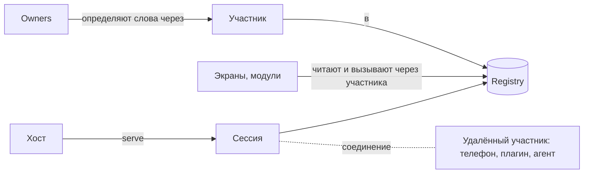

# parlance — справочник терминов

Термины пакета `packages/parlance` на примере дома (`example/house`). Здесь только смысл; принципы — в `философия.md`. Точный контракт описан в `packages/parlance/skills/parlance/references/` (номера разделов указаны как §N).

parlance — это язык, которым части приложения говорят друг с другом, не зная друг друга: слова, права, причины и логи. Поведения в нём нет. Правила вида «когда X, сделай Y» пишет хост в своём коде поверх тиков, фактов и вызовов.

## Основа

**Registry** — общий словарь приложения. Хранит слова и их текущие значения, принимает вызовы, раздаёт изменения тиками. Он один на процесс, `main` получает его как `Host`. Сам registry ни от чьего имени не действует: `main` создаёт его и участников и наблюдает за ним (`explain`, `calls`, `conversation`, `journal`), а определять слова, писать и вызывать можно только через участника.

**Лёгкий хост (§22.5)** — тот же `Host` с `HostLimits.light`: он ничего не помнит дольше того, что есть сейчас. Нет истории тиков, записей вызовов и последних фактов: `recent` пуст, у `explain` нет цепочки, отставший поток получает снимок. Остальное то же: участники, правила, причины, guards, гости через соединение. Чтобы вырасти, меняют пределы, второго реестра нет.

**Ядро (core, §21)** — то, на чём построен registry, внутри пакета: те же слова, только локальные. Это состояния `LocalState` и `LocalKeyedState` с одним писателем, факты `LocalFact`, команды `LocalCommand` с одним обработчиком и `LocalHub`, который коммитит их тиками (`LocalTick`). Отдельной библиотекой ядро не является. Снаружи пакета его не видно.

**Слово (word)** — имя в registry с типом и правилами доступа. Видов четыре: состояние, команда, вопрос, факт. Все слова приложения вместе — его словарь и его публичный API. Полное имя — `<словарь>.<имя>`, с версией `<словарь>.<имя>.v<N>`: `house.light`, `house.set_light`, `house.set_heat.v2`. Имя внутри словаря — одно слово из строчных букв, цифр, `_` и `-`, без точек. Оно всегда пишется в аннотации: `@CommandWord('set_light')`, `version: 2` для новой версии. Поэтому переименование метода в Dart не меняет адрес слова.

**Состояние (state)** — то, что есть сейчас. Его можно прочитать и подписаться на изменения. Пример: `house.heat = 21`.
- **Ключевое состояние (keyed)** держит по значению на каждый ключ, сущность какого-то вида. Пример: `house.light[kitchen] = true`.
- **Пишет только владелец.** Остальные просят его командой, и владелец сам решает, что записать.

**Команда (command)** — просьба что-то сделать: имя, параметры, необязательный ответ. У каждой команды ровно один обработчик. Пример: `house.set_light {room: kitchen, on: true}`. Команда ничего не говорит о том, какие состояния запишет её обработчик: это дело владельца, а что он сделал, видно потом по причинам.

**Вопрос (query)** — слово, которое только отвечает: поиск, страница, снимок по параметрам. Ничего не меняет, поэтому его безопасно спрашивать снова. Нет дедупликации и записи вызова. Запись, факт или вызов команды из его обработчика отклоняются (`QueryEffect`).

**Факт (fact)** — разовое событие без текущего значения. Пример: `house.rang {who: bob}`, `house.motion {room: hall}`.
- **Повтор отбрасывается.** У факта есть id; факт с уже виденным id в окне дедупликации пропускается, поэтому владелец может безопасно повторить.

**Дескриптор (descriptor)** — описание слова: имя, тип, кто может вызывать или читать, `meta` (подпись, единицы).

**Каталог (catalog)** — все слова и варианты, которые есть сейчас. Меняется на ходу: плагин запустился, и его слова появились. `describeFor(principal)` — каталог с точки зрения конкретного участника.

**Статус слова (§6.5)** — есть ли слово для меня сейчас: `WordMissing`, `WordNotPermitted`, `WordUnavailable(why)`, `WordReady`. Спрашивать статус, а не проверять каталог один раз при старте: слова приходят и уходят. Отсутствующее слово ничего не ломает: чтение даёт null, слушатель молчит, пока слово не появится.
- **WordMismatch(breaks)** — слово есть, но не такое, против какого собран код: модуль обновился отдельно, например гость widlet по воздуху. Его даёт статус через типизированное слово или клиент. Правило то же, что у `schemaBreaks` (§25.1, по направлению данных). `breaks` говорит, где разошлось: `type.max: was 100, is 150`. Статус по имени этого не видит, у него нет типа для сравнения. `client.mismatches` перечисляет все такие слова словаря; при разработке его стоит проверять на старте: `assert(client.mismatches.isEmpty)`.
- **Совместимость слов (§25, `references/compatibility.md`)** — вся схема целиком. Одно правило (`keepsPromises`) проверяется в трёх местах: автором до выпуска (`schemaBreaks` против выпущенного), участником при работе (`WordMismatch`) и хостом при работе (`Mismatch`). Опубликованное слово только растёт, ломающее изменение — новое слово рядом со старым. Эталон — то, что выпущено (тег, версия на pub, реестр замороженных версий), а не файл в репозитории.
- **Собран против (built against, §6.9)** — что из слов держит код участника. Клиент при создании сам сообщает реестру весь свой словарь (`view.builtAgainst(words)`); через соединение это уходит хосту и повторяется на новой сессии. Реестр сверяет сообщённое с живыми словами — сразу и при каждом определении, удалении или переопределении слова. `registry.mismatches` и `mismatchChanges` говорят, кто какое слово встречает не таким и из какой версии пакета слов: `Mismatch {by, word, breaks, from}`. Версию пакета генератор берёт из pubspec и пишет в `WordSet.from`. Через соединение слова сообщаются сначала отпечатками (SHA-256 канонической схемы), полная схема — только если хост её не знает. Найденное пишется предупреждением в лог реестра, а без лога при разработке — в `dart:developer`. Это диагностика: ничего не ждёт сообщения и ничего им не отказывается; что делать с расхождением, решает хост. Одно послабление: из вызова такого участника реестр выбрасывает параметры, которых команда больше не принимает, а не отказывает (§25.5).
- **Запасное значение (fallback, §25.2)** — что код читает вместо значения enum или варианта, которого не знает: так добавленное позже значение ничего у него не ломает (как default у enum в Avro). Объявляется в словах: `@Fallback()` на одном значении enum, `unknown:` у `UnionShape` (делает значение из JSON, например подтип `Unknown`, хранящий его). Должно быть уже в той версии слов, против которой собран код. Без него типизированное чтение такого значения даёт `null` (факт не слышен, ответ — `failed`). Так же для любого значения, которое код не может прочитать: нет нужного ему поля, свой `fromJson` класса упал. Удалённый участник один раз сообщает `unreadable` в `errors`, JSON по-прежнему читается по имени, а реестр, встретив такое значение (или значение без нужного поля) в записи, факте или ответе, помечает разрыв как `certain`.
- **Правило совместимости (§25.1)** — судит по направлению данных, как разрешение схем в Avro. То, что код читает (состояние, факт, ответ), он должен прочесть в нынешнем виде слова; то, что код отдаёт (параметры), слово должно принять. Поле в читаемом добавить можно, параметр, который можно не передавать, — тоже; сузить границу читаемого можно, расширить — нет. Каждое расхождение — `WordBreak`: где (`path`), какого рода (`kind`), что было и что стало, и точно ли ломает каждое использование (`certain`) или только некоторые значения.
- **`breaksSince`** — проверка словаря перед выпуском против всех выпусков, что ещё работают (или только последнего).

**Тип (type)** — что может быть значением: `bool`, `int`, `num`, `text`, `enum`, вариант (`ChoiceType`, одно из того, что даёт владелец), объект, список, словарь, `any`. Registry проверяет значения и параметры по типу.

**Варианты (choices)** — то, из чего выбирают ключи keyed-состояний и параметры `@ChoiceOf`: id, подпись и `meta`. Владелец сам отдаёт текущий список (`choices(name: 'room', list: ...)`). Пример: комнаты дома.

**Старое имя (alias) и версии** — слово — это публичный API, поэтому переименованное слово сохраняет старое имя (`host.alias(old, now)`). Несовместимое изменение — новое слово с версией в имени: `orders.order.v2`.

## Кто и почему

**Principal** — кто действует: вид, необязательный id после `/` и необязательный owner после `@`. Примеры:
- `resident/ann` — жилец;
- `phone/ann-phone` — телефон;
- `agent/<сессия>` — ИИ-агент;
- `module/visit` — модуль приложения;
- `guest/bob` — гость;
- `home@house` — часть участника `home`, владелец словаря `house` (часть всегда называется по словарю владельца);
- `system` — сам registry.

Форма principal: `kind[/id][@owner]`, id из одного уровня, owner из одного имени. У principal есть owners: `ofOwner(name)` добавляет `@name`, и в причинах видно, какой owner что сделал. У owner своих owners нет.

**Callers** — кто может вызывать команду: `*` или селектор `kind[/id][@owner]` (`resident`, `module/visit`, `guest`, `home@house`). Селектор покрывает себя и свои части, вид — всех этого вида. Каждое правило — `allow`, `warn` или `deny`. Выигрывает самое близкое; кто не подошёл ни под одно, тому отказ. `warn` разрешает вызов, но редактор предупредит.

**Readers** — кто может читать состояние или слышать факт снаружи процесса: удалённые участники и агенты.

**Askers** — кто может задавать вопрос; по умолчанию те же, кто читает.

**Cause** — почему что-то произошло: от чьего имени (`by`) и из какого сообщения (`parent`). Передаётся сама: всё, что обработчик пишет, говорит и вызывает, следует из вызова, который он обслуживает, и после `await` тоже. По причинам `explain` объясняет, откуда взялось значение.

**Разговор (conversation)** — всё, что выросло из одного сообщения, сколько бы шагов ни было: звонок в дверь, вызов, который он запустил, таймер, который этот вызов поставил, и то, что таймер сделал через минуту. У каждого сообщения разговора одинаковый `conversation` — id сообщения, с которого всё началось. `parent` говорит, что вызвало сообщение, `conversation` — частью чего оно является, `origin` — с чего разговор начался: слово первого сообщения и от чьего имени (`{word, by}`); какой именно это разговор, говорит `conversation`. У первого сообщения origin нет — оно само себе origin (`cause.originOf(word)`). По слову origin находятся все слова, к которым привёл, например, `house.rang` (`JournalReader.startedWith`). Origin даёт registry по родителю и не берёт из cause того, кто действует, поэтому подделать его нельзя; прав он не даёт, права — у `by`. `registry.conversation(id)` отдаёт всё, что registry ещё помнит о разговоре; в телеметрии он лежит в атрибуте `conversation` каждого span, так что по нему ищется в бэкенде через дни и процессы, чего не умеет trace.

**explain (why)** — почему состояние такое: его значение, последнее изменение и цепочка вызовов, которая к нему привела.

## Участники и владельцы (§19, §22)

**Участник (participant)** — часть приложения, как она говорит с registry: один principal, свои словари, свои права. Модуль никогда не держит сам registry, только своего участника. `main` создаёт участника: `host.participant(who, vocabularies:, rights:, access:)`.
- **Словарь (vocabulary)** — набор слов одного owner под общим именем: `house` для `house.set_light`. Участник определяет слова только в своих словарях (`module/visit` только `visit.*`); словарь принадлежит одному участнику, и два словаря одного участника не могут совпадать или вкладываться друг в друга.
- **Права (rights)** — что можно сверх чтения и вызовов: `define` (какие слова объявлять), `speakFor` (от чьего имени).
- **Доступ по умолчанию (access)** — кто может читать и вызывать его слова, если слово само не сказало.
- **Область (scope)** — участник живёт столько, сколько то, чему он служит: вход пользователя, открытая функция. При `dispose` уходит всё, что он сделал.

**Owner** — код, который владеет словами и выполняет их работу. Он наследует сгенерированную базу (`Home extends HouseOwnerBase`) и пишет только обработчики и значения: `heat.set(target)`, `light.set(room, on)`; прочитать своё — `heat.value`, `light.of(room)`, убрать — `heat.remove()`, `light.remove(room)`.
- `host.participant(home, owners: [Home()])` создаёт участника с его owners: каждый приносит свой словарь и действует как owner, названный по нему (`home@house`); у владельца только с правилами словарь без слов. `vocabularies:` пишут только там, где владельцев не видно: гостю через соединение (`host.serve(who, endpoint, vocabularies: [...])`, гость подключает их сам, `part.attach([...])`) и словам, имена которых известны во время работы.
- Чужие слова владелец берёт через их клиента, сделанного в конструкторе: `IHouseClient.of(this)`. Клиент сам находит участника, к которому владельца подключили: `hear(fact: IHouseClient.of(this).rang, onData: ...)`.
- `follow(pull: ..., on: changes)` — owner следует за своей моделью: при каждом её изменении значения переписываются сами.
- Объявлять слова, писать после подключения и убирать за собой owner не должен: это делает база.

**choices** — owner говорит тем, кто опрашивает реестр (агент, редактор, плагин), какие id этого вида сейчас есть и как они подписаны. Нужно для выбора и для проверки `@ChoiceOf`; коду приложения не нужно. Список перечитывается сам, значения ушедших id убираются из keyed-состояний этого вида.

**failCall(why)** — обработчик говорит «нет» по существу. Вызов кончается `failed` с этой причиной.

## Изменения во времени

**Тик (tick)** — единица изменения. Всё, что записано и сказано вместе, коммитится одним тиком: `Tick {epoch, from, to, changes, facts}`. Никто не видит половину тика.

**Batch** — `batch(() {...})`: всё внутри становится одним тиком. `sync()` участника делает так, чтобы изменение всех его owners было одним тиком.

**seq** — порядковый номер каждого изменения и факта внутри эпохи.

**Epoch** — id запуска registry, новый при каждом старте.

**Feed** — поток для удалённых участников: сначала снимок (или сохранённые тики после известного `seq`), потом живые тики.

## Вызовы

**Вызов (call)** — проходит этапы по порядку, первый отказ его останавливает:
1. дедупликация по id (не для вопросов);
2. поиск команды;
3. проверка параметров;
4. проверка `callers`;
5. доступность;
6. guards;
7. обработчик.

**CallResult** — чем кончился вызов:
- `done(value)` — выполнен, единственный вариант с ответом;
- `refused(code, why)` — отказ до запуска. Коды: `unknownCommand`, `invalidParams`, `notPermitted`, `unavailable`, `denied`, `idConflict`;
- `failed(error)` — обработчик сказал «нет» или упал;
- `timedOut` — ответа не было вовремя, но обработчик мог дойти до конца позже;
- `cancelled` — вызывающий отменил вызов (`cancel:`) и перестал ждать. Если обработчик ещё не начал, вызов не выполнялся; если начал — ему сообщили (`expired`), а сделанное остаётся, как при `timedOut`;
- `lost(id)` — ответ потерялся по сети; повтор с тем же id выполнит вызов не больше одного раза.

**Доступность (available)** — проверка владельца «можно ли сейчас», с причиной. Пример: `house.lock` недоступна, пока дверь открыта.

**Guard** — общее правило «нельзя», проверяется на каждом вызове. Кого пропустить, решает сам guard по `by`: переопределения нет (философия, п. 7).

**Call record** — запись о каждом завершённом вызове: кто, что, с каким результатом, сколько заняло (`registry.calls`). `callStarts` сообщает о вызове, когда начинает работать его обработчик, `running` — какие вызовы выполняются сейчас.

## Учёт использования слов (§6.8)

**usesOf / usage** — кто пользовался словом из того, что не видит компилятор: вызовы, подписки удалённых участников, чтения по имени. Считается по имени, которым назвали, так что видно, кто ещё зовёт старое имя. Нужно, чтобы понять, когда старую версию слова можно удалять.

## Типизированные слова и генератор (§18, §23)

**IStateWord / ICommandWord / IQueryWord / IFactWord** — имя слова, его тип в Dart и форма JSON в одном месте. Вызов выглядит так: `participant.command(HouseCommand.setLight).call((room: 'kitchen', on: true))`, от имени участника; у экрана то же на его view.

**Shape** — как Dart-значение проверяется, хранится и превращается в JSON: `PlainShape`, `EnumShape`, `RecordShape`, `UnionShape`, `ListShape`, `MapShape`, `NullableShape`, `JsonShape` (поверх `fromJson`/`toJson` класса, например freezed), `JsonValue` (сам JSON, для слов без Dart-типа). Проверка, равенство и вес у shape дают то же, что тип даёт на JSON значения: те же отказы с теми же путями.

**Хранение как есть (§18)** — слово, которое определил типизированный owner в этом процессе, registry хранит как Dart-значение: что записали, то и прочитают, тем же объектом. JSON строится, только когда его просят: чтение по имени, тик для удалённого участника, журнал, MCP. Слова другого процесса и названные во время работы (плагины, гости WASM) хранятся как JSON, и через соединение всё идёт JSON. Запись сравнивается с тем, что хранилось до неё: совпадающие части не проверяются заново, если их проверка не спрашивает registry (сущности, пользовательские типы). Поэтому запись списка из тысячи элементов с одним изменённым стоит один элемент.

**@Vocabulary** — словарь модуля, написанный один раз абстрактным классом. `parlance_generator` делает по нему enum-слова, базу владельца (`<Class>OwnerBase`, в ней пишутся только обработчики) и клиента для потребителей: интерфейс `I<Class>Client`, который создаётся его же фабриками: `I<Class>Client(participant)` и для владельца `I<Class>Client.of(owner)`. Потребитель (экран, bloc, репозиторий) принимает интерфейс, `main` даёт ему `I<Class>Client`, а тест — подставной объект. Каждое слово у клиента — объект и читается так же, как владелец читает своё: `home.heat.value`, `home.heat.changes`, `home.light.of(room)`, `home.light.all`, `home.rang.payloads`, `home.rang.facts` (факт с сообщением, чтобы owner записал «вслед за чем»). Отказ вызова — `CallNotDone`. Тест подменяет чужие модули только через `TestHost` (`standInState`, `standInKeyed`, `standInCommand`, `standInFact`, `standInChoices`).

## Удалённо (remote, §14)

**Сессия (IRemoteSession)** — подключение одного гостя по соединению. Хост отдаёт гостю участника одним вызовом: `host.serve(who, endpoint, vocabularies: [...])`. Один endpoint — одна сессия. С закрытием сессии уходит участник и его слова; закрытую хостом сессию гость узнаёт (`lost`) и заново не подключается.

**Удалённый участник (IRemoteParticipant, `Host.join`)** — та же часть приложения на другом конце: тот же `IParticipant`, к нему подключаются те же owners. `Host.join(connection)` переподключается сам после обрыва. `Host.joinEndpoint(endpoint)` — поверх готового endpoint, который не возвращается (гость wasm или JS). Это единственный способ работать через соединение; провод, клиент и зеркало — внутренности пакета. Interceptors (например, пара OTel) вешаются на endpoint: на хосте до `serve`, у `join` через `interceptors:`.

**Подписка** — удалённый участник держит только то, на что смотрят его слушатели, и то, что он читал по имени (`fetch`). Слово, которое ему читать нельзя, в подписку не попадает и не мешает остальным.

**Доставка (§14.1)** — что обещано каждому виду сообщений:
- состояние приходит как текущее значение;
- факт — не больше одного раза; после долгого обрыва снимок говорит `factsLost`;
- вызов — один раз на id; `lost` означает «мог выполниться», повторить с тем же id.

Факт, сказанный без связи, ждёт переподключения: хранятся последние `keepAway` (1000). Факт, который нельзя потерять, — это не факт, а состояние у владельца, пока его не обработали.

**Протокол** — не ломается, а растёт. Основная версия (major) одна и не меняется; всё новое приходит как именованная возможность (feature), которую хост перечисляет в `describe`. Участник пользуется возможностью, только если хост её назвал, а незнакомое пропускает. Подключение отклоняется (`ProtocolMismatch`), только если другая основная версия или нет возможности, которую участник требует (`requires`). Имя возможности никогда не меняет смысла: изменение — новое имя рядом, удаление — когда она никому не нужна. Так же участник обходится с тем, что более новый parlance добавит в язык, ведь хост не знает, что понимают его гости: незнакомый тип читается как `UnknownType` (правило увидит другой тип, `WordMismatch`, а не падение), незнакомое право доступа — как `deny`, слово незнакомого вида для него просто отсутствует. Реестр слово незнакомого типа не принимает: он не смог бы проверять его значения. Если хост недоступен, приходит `HostUnreachable`.

## Экраны (view, §20)

Экран, как и любая часть, пользуется словами через клиента (`IHouseClient(participant)`). То, на чём клиент построен, — инструмент (`tools.dart`):

**IRegistryView** — синхронное чтение, уведомления об изменениях нужных состояний, вызовы от имени одного principal.
- **LocalView** — поверх registry в своём процессе.
- **Удалённый участник** — тоже view.

**GeneratedWords** — единственная дверь, через которую сгенерированные база владельца и клиент обращаются к словам: `GeneratedWords(participant)` (для клиента владельца `GeneratedWords.of(owner)`). Это контракт генератора, а не способ писать руками. Она даёт `GeneratedState` и `GeneratedFact` (`define`), `GeneratedCommand` (`serve`, `call`) и `GeneratedQuery` (`serve`, `ask`) — других типизированных путей к слову нет.

**fetch(state)** — чтение по имени, в том числе того, на что не подписан: так читают плагины и агенты. Через соединение участник с этого момента следит за словом; `keep: false` — посмотреть один раз.

## Агенты (пакет parlance_mcp, §16)

**Агент — это участник.** Инструменты MCP (отдельный пакет `parlance_mcp`) работают поверх его `IParticipant`, в процессе или через соединение: `parlanceTools(participant)`.

**parlanceTools** — готовый набор инструментов агента: `describe`, `read`, `call`, `recent_facts`, `why`, плюс по инструменту на каждую команду, если попросить.

## Логи и телеметрия (§9.2)

**Лог** — `Host(log:)`, `LogScope` логгера rpc_dart; без него ничего не пишется и не создаётся.

**Span** — каждый вызов при включённом логе. Телеметрию выключает `LogController(spansEnabled: false)`; без синков она тоже ничего не стоит. Вложенный вызов — дочерний span. Вызов, выросший из факта, ссылается на span, в котором факт сказан. Через соединение trace продолжается у удалённого владельца.

## Журнал (§9.3)

**Журнал** — `registry.journal`, что было сделано в системе на уровне пользования, в одном порядке: каждый вызов при начале и при конце (отказы тоже), каждый сказанный факт и каждая запись состояния внутри разговора (у её cause есть `parent`). Собственные записи owner'а о том, как мир устроен сейчас (уровни, таймеры), — не история и в журнал не идут: то, что стоит помнить, owner говорит фактом. Логи и spans рассказывают, как работал код, и могут быть выключены; журнал — запись того, кто что сделал и вслед за чем.

- Поток синхронный, registry ничего из него не хранит: хост пишет его туда, где он не потеряется. `parlance_journal` пишет JSON-строки, файл на день, и читает обратно: разговор целиком (`conversation`), разговор любого сообщения по его id (`of`), путь к сообщению от начала разговора по цепочке `parent` (`pathTo`), разговор деревом для визуализации (`tree`: что к чему привело, у вызова — чем кончился и сколько шёл), всё, что выросло из одного слова (`startedWith`), всё в одном trace (`trace`), связи, которые реально есть (`links`: кто что вызывает вслед за чем, отказы отдельно).
- У каждой записи `epoch`, `n`, `kind`, `conversation`, `origin`, а при включённых spans — `trace` (W3C `traceparent`). По `conversation` разговор находится в бэкенде телеметрии и в строках лога registry, по `trace` — его spans и события.

## Тесты (§24)

**TestHost** — registry для теста:
- заглушки модулей, которые тест не поднимает: `standInState`, `standInCommand`, `standInFact`;
- модуль под тестом в процессе или через соединение (`join`);
- что произошло: `written`, `said`, `callsOf`.

## Что убрано из parlance

Убрано, потому что описывало поведение, которое расходится с кодом, или было нужно на всякий случай:
- **связи (links)**: реакции, привязки, ограничения, контролы, кнопки, команды из сообщений;
- **слои** и `temporarily`;
- `flip` и `sets`;
- `uses` и декларации;
- before-хуки, `interceptable`, `hurry`;
- метка `test` и `chain` в причинах;
- `RegistryResponder`, `ParlanceClient`, `RemoteOwner`, зеркало и доски MCP как публичный API;
- открытые факты с несколькими производителями и переопределение запретов (философия, п. 2 и 7);
- ядро как отдельная библиотека и `LocalRegistry`: лёгкий хост — тот же `Host`.

Правила «когда X, сделай Y» и «пока никого нет дома, держи Z» — код хоста (его owners) поверх тиков, фактов и вызовов.

Реакции, записанные данными, вернулись отдельным пакетом поверх языка — `parlance_links`. Связи исполняет участник, которому они принадлежат, с его правами и не больше. Триггеры: факт, состояние, время, кнопка. Шаги: вызов и ожидание. `conversationLimit` ограничивает, сколько раз связи могут сработать в одном разговоре, поэтому связи, запускающие друг друга, останавливаются.
